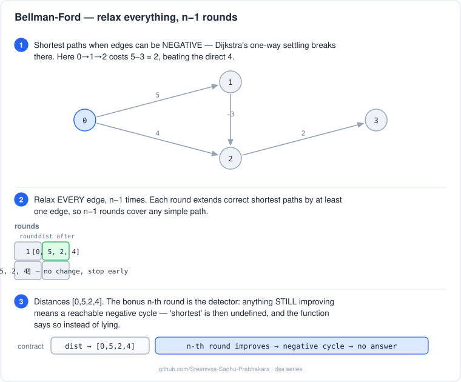

# Bellman–Ford

> Striver SDE Sheet 166 · Day 24 Graph II — V−1 rounds of relaxing every edge; a V-th round that still improves something convicts a negative cycle. Go, stdlib only, tested.

## Problem

Single-source shortest paths when edges may be **negative** — Dijkstra's no-go zone — including detecting the case where no answer exists: a negative cycle reachable from the source.

## Approach

Relax every edge, V−1 times. The induction: after round k, all shortest paths using ≤ k edges are final, and no simple path has more than V−1 edges — so V−1 rounds settle everything *unless* a negative cycle keeps feeding improvements, which is exactly what the extra verification pass checks. The `dist[u] != inf` guard stops infinity from "relaxing" into unreachable regions (and from overflowing). An early exit when a full round changes nothing makes the typical case far cheaper than the worst case. Note the honest edge case the tests pin: a negative cycle *unreachable* from the source doesn't invalidate the reachable answers.

**Complexity:** O(V·E) time, O(V) space.

## Visual walkthrough

Read the picture top to bottom — each numbered frame is one moment of the algorithm
running on this repo's test example.

## Run

    go test ./...   # verify
    go run .        # demo

---

One of 191 repos solving Striver's SDE Sheet in Go — stdlib only, one problem per repo, every solution tested. Browse the set: [`dsa-*` repos](https://github.com/Sreenivas-Sadhu-Prabhakara?tab=repositories&q=dsa-&type=source).
